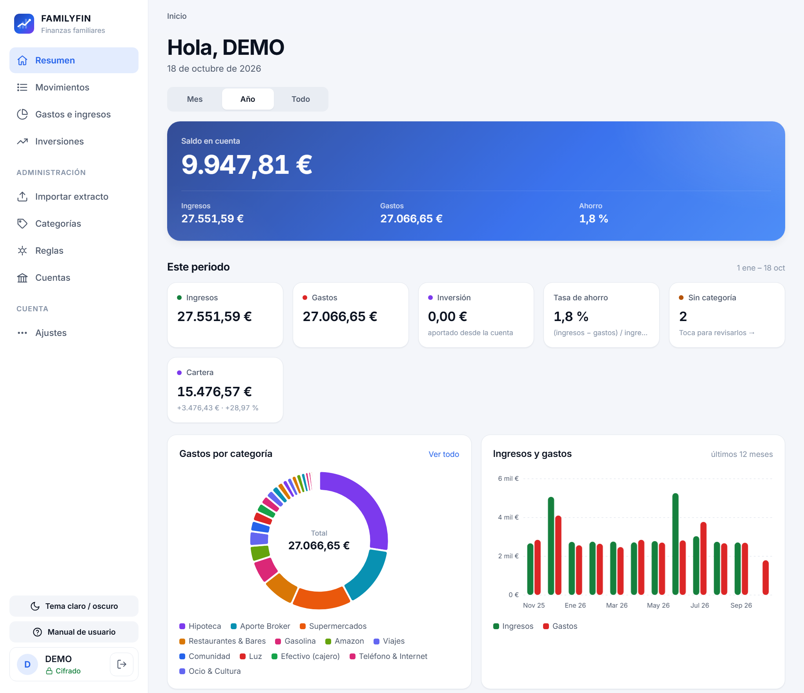
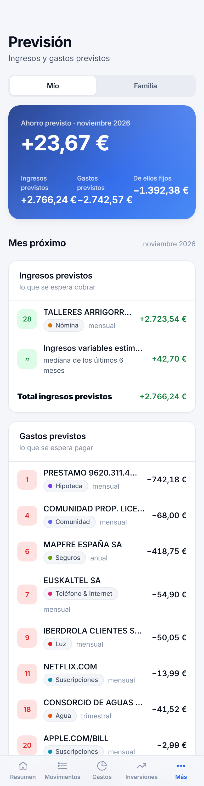

<div align="center">

# FAMILYFIN

**Gestor de finanzas personales y familiares para Windows, con acceso desde iPhone/iPad en la red de casa.**

[](https://github.com/pbermudezcc/PROFIN/releases/tag/v0.8.3-beta.1)
[](https://github.com/pbermudezcc/PROFIN/releases/latest)
[](https://www.python.org/)
[](https://doc.qt.io/qtforpython-6/)
[](#requisitos)
[](#tests)

[Características](#características) ·
[Instalación](#instalación) ·
[Uso](#uso) ·
[Especificación](#especificación-funcional) ·
[Arquitectura](#arquitectura) ·
[Desarrollo](#desarrollo)

</div>

---

## Tabla de contenidos

- [Sobre el proyecto](#sobre-el-proyecto)
- [Características](#características)
- [Stack tecnológico](#stack-tecnológico)
- [Requisitos](#requisitos)
- [Instalación](#instalación)
- [Uso](#uso)
- [Especificación funcional](#especificación-funcional)
- [Arquitectura](#arquitectura)
- [Datos, copias de seguridad y privacidad](#datos-copias-de-seguridad-y-privacidad)
- [Desarrollo](#desarrollo)
- [Solución de problemas](#solución-de-problemas)
- [Roadmap](#roadmap)
- [Versionado](#versionado)
- [Contribuir](#contribuir)
- [Seguridad](#seguridad)
- [Licencia](#licencia)

---

## Sobre el proyecto

**FAMILYFIN** (el repositorio se llama `PROFIN`) es una aplicación de escritorio que:

1. **importa** los extractos del banco,
2. **categoriza** los movimientos automáticamente con reglas,
3. **muestra** en qué se va el dinero,
4. **prevé** los ingresos y gastos del mes próximo a partir de los recibos fijos, y
5. lleva el **seguimiento de una cartera de inversiones** con su rentabilidad y su fiscalidad.

Nació para una familia, pero cualquier persona u hogar puede usarla. Cada usuario tiene sus propios
datos, separados y protegidos por contraseña. La vista **Familia** suma a todos los miembros solo con
totales, sin enseñar los movimientos de nadie.

<p align="center">
  
  &nbsp;
  
</p>
<p align="center"><sub>Capturas con datos de demostración (usuario DEMO).</sub></p>

### Principios de diseño

| Principio | Qué significa |
|---|---|
| **Local primero** | Todo se guarda en tu PC. No hay nube, servidor externo ni cuentas en terceros. |
| **Nada se guarda sin confirmar** | Las importaciones muestran una vista previa y no escriben nada hasta que confirmas. |
| **Lo manual manda** | Las reglas automáticas nunca sobrescriben una categoría puesta a mano. |
| **Una sola lógica** | El escritorio y la web comparten el mismo código de negocio y se comportan igual. |
| **Datos protegidos** | Hay migraciones automáticas con copia previa y copias de seguridad periódicas. |

La única conexión a Internet que hace la app es la descarga **opcional** de cotizaciones desde Yahoo Finance.

---

## Características

| Área | Funcionalidad |
|---|---|
| 📊 **Resumen** | Ingresos, gastos, ahorro y evolución por mes, año, todo o un periodo **personalizado** (desde / hasta) |
| 🔮 **Previsión** *(nuevo, beta)* | Media mensual de gastos fijos y variables, recibos y cobros de este mes, ingresos y gastos previstos del mes próximo y aportaciones de cada miembro a la cuenta común |
| 💸 **Gastos / Ingresos** | Desglose por categoría con gráficos y comparativa entre periodos |
| 🔎 **Movimientos** | Búsqueda por todos los campos, filtros (también fijo / variable / traspaso), cambio de categoría y aplicación a movimientos iguales |
| 📥 **Importar** | Uno o varios extractos Excel de CaixaBank a la vez, con vista previa y detección de duplicados |
| 🏷️ **Categorías y reglas** | Árbol de categorías marcadas como Fijo, Variable o Traspaso interno; reglas por comercio o concepto, con prioridad y por tipo de movimiento; exportar e importar la biblioteca entre usuarios |
| 📈 **Inversiones** | Cartera FIFO con efectivo del bróker, cotizaciones, TIR, comparación con índices, informe fiscal, importación de DEGIRO y MyInvestor |
| 📱 **Acceso web** | Versión web para iPhone/iPad en la red local, siempre por HTTPS, con invitaciones para la familia |
| 👤 **Mi cuenta** | Cambiar contraseña y nombre, descargar mis datos, borrar la cuenta con copia previa |
| ⚙️ **Configuración** | Tema claro/oscuro, carpeta de datos, copias de seguridad automáticas |
| ❓ **Ayuda** | Manual de usuario integrado (botón «?» en el PC, enlace en la web) y usuario **DEMO** para enseñar la app |

---

## Stack tecnológico

| Capa | Tecnología |
|---|---|
| Lenguaje | Python 3.11 |
| Interfaz de escritorio | [PySide6](https://doc.qt.io/qtforpython-6/) (Qt 6) + [qtawesome](https://github.com/spyder-ide/qtawesome) |
| Persistencia | SQLite + [SQLAlchemy 2](https://www.sqlalchemy.org/), con migraciones de esquema automáticas |
| Lectura de Excel | pandas, openpyxl, xlrd |
| Seguridad | bcrypt (contraseñas), cryptography (certificado TLS propio) |
| Web local | [FastAPI](https://fastapi.tiangolo.com/) + Uvicorn + Jinja2 (servidor dentro de la app de escritorio) |
| Datos de mercado | [yfinance](https://github.com/ranaroussi/yfinance) |
| Tests | pytest (+ httpx para el cliente de pruebas de FastAPI) |
| Empaquetado | PyInstaller |

---

## Requisitos

- **Windows 10 u 11.** Es la plataforma objetivo, porque el empaquetado y las rutas de datos usan `%LOCALAPPDATA%`.
- **Python 3.11**, solo si se ejecuta desde el código fuente.
- *(Opcional)* Conexión a Internet para las cotizaciones.
- *(Opcional)* iPhone/iPad en la **misma red Wi-Fi** que el PC para el acceso web.

---

## Instalación

### Opción A: ejecutable (usuarios finales)

1. Descarga el `.zip` de la última versión desde **[Releases](https://github.com/pbermudezcc/PROFIN/releases/latest)**.
2. Descomprímelo en una carpeta, por ejemplo `C:\Programas\FAMILYFIN`.
3. Ejecuta `FAMILYFIN.exe`. No funciona si se separa de la carpeta `_internal\` que trae el zip.

No hace falta instalar Python.

> [!NOTE]
> **Versiones estables y de prueba.** «Latest» es siempre la última versión estable (ahora la **0.8.2**).
> Las versiones de prueba, como la **[0.8.3-beta.1](https://github.com/pbermudezcc/PROFIN/releases/tag/v0.8.3-beta.1)**
> con Previsión, aparecen en Releases marcadas como *Pre-release*. Al abrir una versión nueva la base de
> datos se actualiza sola (la 0.8.3-beta.1 pasa del esquema v8 al v9), siempre con una copia previa.

### Opción B: desde el código fuente (desarrolladores)

```powershell
git clone https://github.com/pbermudezcc/PROFIN.git
cd PROFIN

# Entorno virtual aislado
py -3.11 -m venv .venv
.\.venv\Scripts\Activate.ps1

# Dependencias
python -m pip install --upgrade pip
pip install -r requirements.txt

# Arrancar
python main.py
```

> [!IMPORTANT]
> **pandas está fijado a la versión `3.0.3`.** En algunos equipos con *Smart App Control* de Windows,
> las versiones 3.0.5/3.0.6 se bloquean al cargar sus DLL nativas. No cambies la versión sin probarla
> antes en un entorno aislado.

### Opción C: generar tu propio ejecutable

```powershell
build_profin.bat
```

El resultado se genera en `dist\`. Por debajo llama a `tools\build_windows.py`.

---

## Uso

### Primeros pasos

1. **Crea tu usuario.** En la pantalla de inicio del PC, pulsa **«¿Primera vez? Crear cuenta»**. Cada miembro del hogar
   puede tener su propio usuario; desde el móvil, un miembro invita a otro con un código de un solo uso.
2. **Prepara las categorías.** En **Categorías**, carga las categorías por defecto, crea las tuyas o importa la
   biblioteca (`.profin-cats.json`) de otro miembro.
3. **Importa extractos.** Descarga el Excel de movimientos desde la banca online de CaixaBank y ábrelo en **Importar**
   (puedes elegir varios a la vez). Revisa la vista previa (nuevos, posibles duplicados, ya importados) y confirma.
4. **Categoriza.** Al asignar una categoría a un movimiento puedes además:
   - ☑️ *Aplicar también a N movimientos iguales* que aún no tienen categoría;
   - ☑️ *Crear una regla para los próximos* gastos o ingresos de ese comercio.
5. **Marca lo fijo.** En **Categorías**, indica qué categorías son **Fijo** (hipoteca, luz, seguros, nómina…) y cuáles
   son **Traspaso interno** entre miembros. **Previsión** te propone las primeras la primera vez que la abres.
6. *(Opcional)* **Inversiones.** Registra operaciones a mano o importa el estado de cuenta de DEGIRO o MyInvestor.
7. *(Opcional)* **Acceso desde el móvil.** Ve a **Configuración → Acceso web**.

El manual completo, con capturas del PC, del iPad y del iPhone, está en [`docs/manual/index.html`](docs/manual/index.html)
y se abre desde la propia app.

### Acceso desde iPhone / iPad

1. En el PC: **Configuración → Acceso web → Activar**.
2. En el móvil, escanea el **código QR** para instalar el certificado de casa. Solo hace falta la primera vez en cada dispositivo.
3. Abre la dirección que muestra la app (puerto **8765** por defecto) e inicia sesión con tu usuario.
4. *(Opcional)* Safari → Compartir → **Añadir a pantalla de inicio**, para usarla como una app.

---

## Especificación funcional

<details>
<summary><b>Usuarios y sesión</b></summary>

- Usuarios locales con contraseña cifrada con **bcrypt**. Las contraseñas nuevas tienen entre 8 y 64 caracteres,
  no pueden ser el nombre ni una contraseña muy común, y no se admiten nombres casi iguales («Ana» / «ana»).
- **Aislamiento por usuario:** cuentas, movimientos, categorías, reglas e inversiones pertenecen a un único usuario.
- Hay reglas **globales** (compartidas) y reglas **personales** de cada usuario.
- **Invitaciones:** desde la web, un miembro genera un código de un solo uso que caduca a los 15 minutos. Sin código
  nadie puede registrarse desde la red de casa.
- **Mi cuenta** (PC y web): cambiar la contraseña (cierra las sesiones de otros dispositivos) y el nombre, y borrar la
  cuenta. Antes de borrarla se guarda una copia completa; si la copia falla, no se borra nada.
- **Descargar mis datos:** tras confirmar la contraseña, cada miembro descarga sus movimientos, cuentas, categorías,
  reglas e inversiones en Excel, y su biblioteca de categorías. Solo los suyos.
- **Usuario DEMO:** para enseñar la app sin mostrar datos de la familia; no ve las reglas globales ni la vista Familia.
- Se guarda un **registro de auditoría** (`audit_log`) de las acciones relevantes.

</details>

<details>
<summary><b>Importación de extractos bancarios</b></summary>

- **Formato soportado:** Excel de movimientos de **CaixaBank** (`.xls` / `.xlsx`).
- **Proceso:**
  ```
  lectura → validación → detección de duplicados → categorización con reglas → vista previa → confirmación
  ```
- **Varios extractos a la vez:** se comprueban uno a uno; los movimientos repetidos entre extractos que se solapan se
  importan una sola vez, y los archivos que no sirven se avisan con el motivo sin frenar al resto.
- Los movimientos de un mismo día conservan el orden del banco, y el «Saldo en cuenta» toma el último del día.
- Cada importación se registra como un **lote** (`ImportBatch`), así se sabe de qué fichero viene cada movimiento.
- **Desde la web** se puede subir el Excel desde la app *Archivos* del iPad. El fichero temporal se borra al terminar, y los ficheros que hayan quedado de importaciones sin confirmar se limpian al arrancar el servidor.

</details>

<details>
<summary><b>Categorización</b></summary>

- La jerarquía tiene dos niveles: **Tipo → Categoría**. Por ejemplo, *Gasto → Supermercado*.
- **Reglas automáticas:** coincidencia exacta o parcial sobre el comercio o el concepto, con **prioridad** configurable.
- Cada regla vale para **cualquier movimiento, solo gastos o solo ingresos**: un BIZUM que pagas y uno que cobras
  pueden ir a categorías distintas.
- Al editar una regla se ve en el momento a qué movimientos afecta. Las reglas se pueden buscar y filtrar.
- **Invariante:** una regla nunca sobrescribe una categoría asignada manualmente.
- **Movimientos iguales:** se consideran iguales los del mismo comercio y del mismo tipo. Un gasto nunca se mezcla con una devolución.
- **Tipo de gasto:** cada categoría es **Variable** (por defecto), **Fijo** o **Traspaso interno**; en un traspaso se
  indica «Con» qué miembro. Un movimiento concreto puede salirse de su categoría (fijo o variable).
- **Biblioteca:** las categorías, reglas y marcas se exportan a un `.profin-cats.json` y se importan en otro usuario o
  PC, fusionando (solo añade lo que falta) o reemplazando, siempre con vista previa.

</details>

<details>
<summary><b>Previsión</b> <i>(beta, desde 0.8.3-beta.1)</i></summary>

- **Media mensual** de ingresos y gastos fijos y variables sobre los últimos 12 meses completos. El gasto y el ingreso
  variables se estiman con la mediana de los últimos 6 meses.
- **Recibos y cobros fijos:** se agrupan por categoría y emisor, y se deduce su frecuencia (mensual, bimestral,
  trimestral, cuatrimestral, semestral o anual). Los que no llegan cada mes se reparten en la media, pero solo
  aparecen en la previsión el mes en que tocan. Un recibo un 20 % por encima de lo habitual se señala.
- **Este mes:** cobros y recibos marcados como cobrados, cargados o pendientes.
- **Mes próximo:** ingresos previstos y gastos previstos en dos listas separadas, con su total y el ahorro previsto.
- **Aportaciones:** con los traspasos marcados, se ve cuánto envía cada miembro a la cuenta común, se avisa si lo
  enviado y lo recibido no cuadran y se estima la aportación de cada uno el mes próximo.
- **Vista Familia:** suma a todos los miembros solo con totales; los traspasos internos no se cuentan dos veces.
- Las categorías de inversión quedan fuera, y las devoluciones se compensan dentro de su categoría.

</details>

<details>
<summary><b>Inversiones</b></summary>

- **Operaciones:** compra, venta, dividendo y split, en cualquier divisa.
- **Cartera calculada con FIFO**, el método que exige la normativa fiscal española.
- Cotizaciones y tipos de cambio que se descargan en segundo plano y se guardan para poder trabajar **sin conexión**.
- **Efectivo del bróker:** el valor de la cartera suma el efectivo sin invertir (el «Margen libre» de DEGIRO), así cuadra
  con la «Cuenta completa» del bróker. La plusvalía y la rentabilidad siguen siendo las de los valores.
- **Indicadores:** valor, plusvalía, **TIR** (rentabilidad anualizada), realizado y dividendos.
- **Benchmark:** comparación con MSCI World, S&P 500 o IBEX 35 simulando las mismas aportaciones.
- **Distribución** por valor, bróker, divisa o tipo de activo.
- **Informe fiscal anual** de ventas y dividendos con la regla de recompra (2 meses, o 1 año en fondos), exportable a Excel.
- Avisos de **dividendos y splits pendientes** de registrar.
- **Importadores:**
  - **DEGIRO** («Estado de cuenta»): junta ejecuciones parciales, añade comisiones e impuestos y valora los dividendos en euros recibidos.
  - **MyInvestor:** propone tipo, valor y participaciones, que se pueden corregir antes de importar (de momento, solo desde el PC).
  - Los dos importadores evitan duplicar lo que ya se importó.

</details>

<details>
<summary><b>Acceso web</b></summary>

- **Servidor embebido:** se ejecuta dentro de la app de escritorio y se activa o desactiva desde la propia app.
- **Siempre HTTPS**, con una autoridad certificadora local que se genera en el PC.
- **Solo en la red local:** no se expone nada a Internet.
- Sesión por usuario con **cierre automático tras 30 minutos** sin uso.
- **Funciones:**
  - consultar el resumen, la previsión, los gastos, los ingresos, los movimientos y las inversiones;
  - cambiar categorías, marcar movimientos como fijos y gestionar categorías, reglas y la biblioteca;
  - importar extractos de CaixaBank y el estado de cuenta de DEGIRO;
  - registrar operaciones de inversión y actualizar cotizaciones (las descarga el PC);
  - invitar a la familia, gestionar la propia cuenta y descargar los datos.
- La versión de la app se ve al pie de la barra lateral y en Ajustes, solo con la sesión iniciada.
- Diseño adaptado a iPhone y iPad (vertical y horizontal). Se puede instalar como app en la pantalla de inicio.

</details>

---

## Arquitectura

```
PROFIN/
├── main.py                  # Punto de entrada: logging → BD → login → ventana principal
├── app/
│   ├── config.py            # Nombre, versión y temas (claro/oscuro)
│   ├── db/                  # Modelos SQLAlchemy, conexión y migraciones de esquema
│   ├── auth/                # Alta de usuarios, login y sesión
│   ├── ingestion/           # Parser Excel, validación, duplicados, servicio de importación
│   ├── categorization/      # Categorías, motor de reglas, administración
│   ├── analytics/           # Resúmenes por periodo, dashboard, búsqueda, previsión
│   ├── investments/         # Ledger, cartera FIFO, precios, TIR, fiscalidad
│   │   └── importers/       #   DEGIRO, MyInvestor
│   ├── settings/            # Preferencias, copias de seguridad, «Descargar mis datos»
│   ├── gui/                 # Vistas PySide6 (una por sección)
│   └── web/                 # FastAPI: routers, plantillas Jinja2, TLS, servidor
├── tests/                   # Suite pytest
├── tools/                   # Build, releases, iconos web, previsualización web, demo
├── docs/
│   ├── manual/              # Manual de usuario (HTML + capturas), se abre desde la app
│   └── agent/               # Registro de desarrollo y lecciones aprendidas
├── CHANGELOG.md
└── requirements.txt
```

### Capas

```
┌──────────────────────────┐   ┌──────────────────────────┐
│  Escritorio (app/gui)    │   │  Web local (app/web)     │
│  PySide6                 │   │  FastAPI + Jinja2 + TLS  │
└────────────┬─────────────┘   └────────────┬─────────────┘
             └──────────────┬───────────────┘
                            ▼
      ┌────────────────────────────────────────────┐
      │  Lógica de negocio (sin dependencias Qt)   │
      │  ingestion · categorization · analytics    │
      │  investments · auth · settings             │
      └─────────────────────┬──────────────────────┘
                            ▼
      ┌────────────────────────────────────────────┐
      │  Persistencia: SQLAlchemy 2 → SQLite       │
      └────────────────────────────────────────────┘
```

La lógica de negocio **no importa Qt**. El escritorio y la web la comparten, así que se comportan igual
y la lógica se puede probar sin interfaz gráfica.

### Modelo de datos

| Tabla | Contenido |
|---|---|
| `users` | Usuarios y hash de contraseña |
| `accounts` | Cuentas bancarias de cada usuario |
| `categories` | Árbol Tipo → Categoría, con su tipo de gasto (Fijo / Traspaso interno) y el miembro «Con» |
| `transactions` | Movimientos bancarios (con la marca fijo / variable propia, si la tienen) |
| `import_batches` | Lotes de importación (trazabilidad) |
| `auto_categorization_rules` | Reglas automáticas (globales o personales, para cualquier movimiento, gastos o ingresos) |
| `audit_log` | Registro de acciones |
| `securities` | Valores: acciones, ETF, fondos… |
| `investment_transactions` | Operaciones de inversión |
| `price_history` | Cotizaciones históricas guardadas |
| `fx_rates` | Tipos de cambio |
| `broker_cash` | Efectivo sin invertir en cada bróker |

El esquema actual es el **v9**. Las migraciones se aplican solas al abrir la app (`PRAGMA user_version`).

---

## Datos, copias de seguridad y privacidad

| Qué | Ubicación por defecto |
|---|---|
| Base de datos (SQLite) | `%LOCALAPPDATA%\FAMILYFIN\data\` (se puede cambiar en *Configuración*) |
| Logs | `%LOCALAPPDATA%\FAMILYFIN\logs\profin.log` (en desarrollo, en `logs\` del repositorio) |
| Preferencias | Registro de Windows (QSettings, «FAMILYFIN») |

- **Copias automáticas** cada 24 h por defecto, a una carpeta configurable.
- **Migraciones seguras:** antes de actualizar el esquema se guarda `profin.pre-migration-vN.<fecha>.db` junto a la base.
- Los logs rotan automáticamente (1 MB × 3 ficheros).

> [!WARNING]
> El `.gitignore` excluye `*.db`, `data/` y los `.zip` de copias de seguridad.
> **Nunca subas datos financieros reales al repositorio.**

---

## Desarrollo

### Configurar el entorno

Sigue la [Opción B](#opción-b-desde-el-código-fuente-desarrolladores) de la instalación.

### Tests

```powershell
pytest                                 # suite completa
pytest tests/test_rules_engine.py -v   # un módulo
pytest -k "duplicate"                  # por nombre
```

La suite (724 pruebas, cobertura del 87 %) cubre parsers, detección de duplicados, motor de reglas, migraciones,
previsión, inversiones (FIFO, TIR, fiscalidad, importadores), la web (incluidos TLS y la política de seguridad de
las plantillas) y las pantallas del PC en modo *offscreen*. Ninguna prueba toca la carpeta de datos real.

### Previsualizar la web

```powershell
python tools/web_preview.py          # http://localhost:8765  (demo / demo-pass  o  familia / familia-pass)
python tools/web_preview.py --reset  # regenera la base de datos de demo
```

Usa una base de datos **de demostración** en `dist/web_preview/` y nunca toca los datos reales. Con dos usuarios se
puede probar la vista Familia.

### Convenciones

- **Ramas:** `main` es estable; el trabajo se hace en `feature/<tema>` o `fix/<tema>`.
- **Commits:** [Conventional Commits](https://www.conventionalcommits.org/es/), por ejemplo `feat(web): …`, `fix(ingestion): …`, `docs: …`, `chore(deps): …`.
- **Antes de tocar** la importación, las migraciones o la base de datos, lee [`docs/agent/lessons_learned.md`](docs/agent/lessons_learned.md).
- La lógica nueva va en las capas sin Qt y se reutiliza desde `gui/` y `web/`.

---

## Solución de problemas

| Síntoma | Causa probable / solución |
|---|---|
| Error al cargar pandas / la página *Importar* aparece como no disponible | *Smart App Control* bloquea las DLL de pandas. Comprueba que tienes `pandas==3.0.3`. |
| El iPhone muestra «Conexión no privada» | El certificado de casa no está instalado o no es de confianza. Vuelve a escanear el QR y actívalo en *Ajustes → General → Información → Ajustes de confianza de certificados*. |
| No se puede abrir la web desde el móvil | El PC y el móvil deben estar en la misma Wi-Fi, y el Firewall de Windows debe permitir el puerto (8765 por defecto). |
| Previsión sale vacía o casi vacía | Ninguna categoría está marcada como **Fijo**. Acepta las sugerencias de Previsión o márcalas en *Categorías*. Hacen falta unos meses completos de movimientos. |
| Las aportaciones a la cuenta común no aparecen | Marca la categoría de esos movimientos como **Traspaso interno** e indica en «Con» el otro miembro, en los dos usuarios. |
| Las cotizaciones no se actualizan | Comprueba la conexión a Internet. La app sigue funcionando con los últimos precios guardados. |
| Algo falla y no sabes qué | Revisa `profin.log` (ver [Datos](#datos-copias-de-seguridad-y-privacidad)). |

---

## Roadmap

- [x] Importación de CaixaBank con detección de duplicados
- [x] Reglas automáticas de categorización
- [x] Módulo de inversiones (FIFO, TIR, fiscalidad, DEGIRO, MyInvestor)
- [x] Acceso web HTTPS para iPhone/iPad
- [x] Exportar e importar la biblioteca de categorías y reglas
- [x] Manual de usuario integrado y usuario DEMO
- [x] Invitaciones y gestión de la cuenta desde el móvil
- [x] Exportación de datos («Descargar mis datos»)
- [x] Previsiones, gastos fijos y aportaciones a la cuenta común *(beta en 0.8.3-beta.1)*
- [ ] Previsiones en versión estable
- [ ] Importar MyInvestor desde la web
- [ ] Soporte para extractos de otros bancos

---

## Versionado

El proyecto usa el formato **`X.Y.Z`**:

| Parte | Significado |
|---|---|
| **X** | Release mayor |
| **Y** | Nueva fase principal de desarrollo |
| **Z** | Funcionalidad o corrección |

Las versiones de prueba llevan el sufijo `-beta.N` (por ejemplo `0.8.3-beta.1`) y se publican como *Pre-release*.

Cada versión se publica en [GitHub Releases](https://github.com/pbermudezcc/PROFIN/releases) con el ejecutable
empaquetado en un `.zip`. El historial completo está en [`CHANGELOG.md`](CHANGELOG.md).

| Versión | Fecha | Lo más destacado |
|---|---|---|
| **0.8.3-beta.1** *(prueba)* | 2026-10-31 | Previsión, Fijo / Traspaso interno, periodo personalizado en el Resumen |
| **0.8.2** | 2026-10-30 | Reglas por tipo de movimiento, «Descargar mis datos», contraseña y nombre desde el PC |
| **0.8.1** | 2026-10-28 | Invitaciones, Mi cuenta en el móvil, varios extractos a la vez |
| **0.8.0** | 2026-10-27 | DEGIRO y cotizaciones desde la web, efectivo del bróker, biblioteca de categorías, manual |

---

## Contribuir

1. Haz un *fork* del repositorio y crea una rama: `git checkout -b feature/mi-mejora`.
2. Escribe tests para el cambio y comprueba que `pytest` pasa entero.
3. Usa mensajes de commit con el formato Conventional Commits.
4. Abre un *Pull Request* contra `main` explicando qué cambia y por qué.

**Una buena primera contribución:** un parser para otro banco en `app/ingestion/`, siguiendo el modelo de `excel_parser.py`.

---

## Seguridad

- Las contraseñas se guardan con **bcrypt**; nunca en texto plano.
- La web solo funciona por **HTTPS** y únicamente en la red local.
- Si encuentras una vulnerabilidad, **no abras un issue público**: contacta directamente con el mantenedor a través de GitHub.

---

## Licencia

Pendiente de definir. Mientras no haya un archivo `LICENSE`, todos los derechos están reservados al autor.

---

<div align="center">
Hecho con ❤️ para gestionar mejor las finanzas de casa.
</div>
